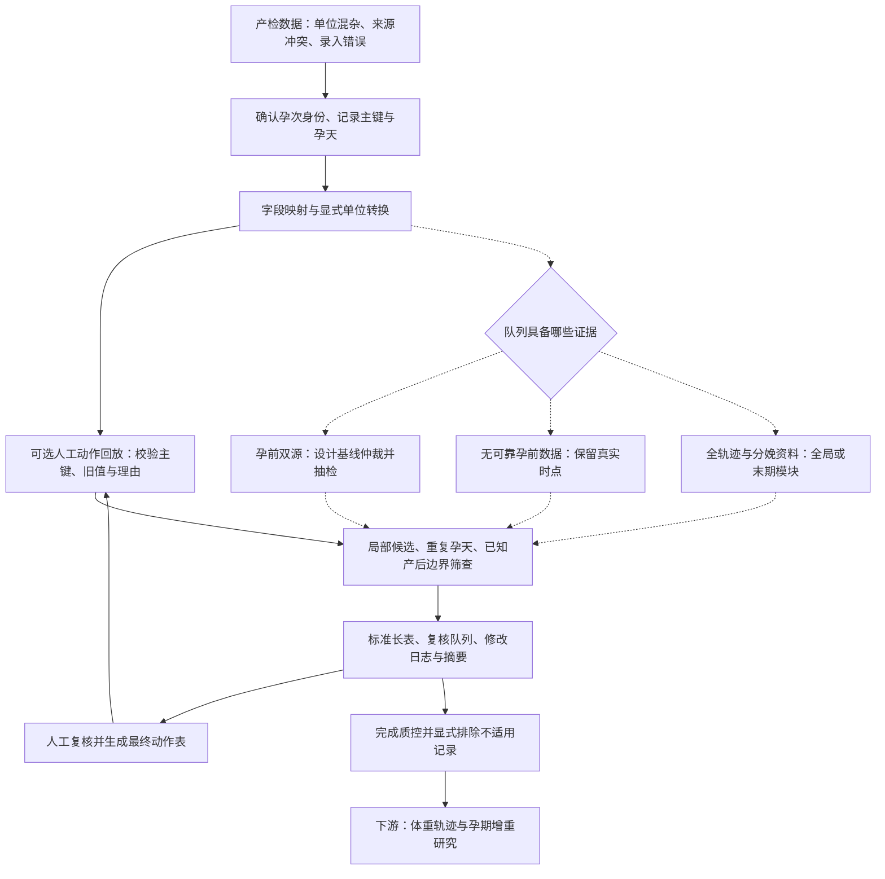

# 妊娠期体重时序清洗：规则、复核与跨队列适配

医院产检数据存在斤与公斤混用、数值录入错误、孕前体重来源冲突及产后记录混入孕期序列等问题。本项目源于宝安队列，并结合龙岗、广西的实际适配经验，提供可追溯的数据整理组件与流程设计参考，为孕期增重和体重轨迹研究准备数据。

目标是让研究者按自己的数据来源、基线信息和分娩资料搭建流程。真实高体重、早孕下降和产后下降需要分别处理。

## 从哪里开始

| 需求 | 入口 |
|---|---|
| 立即试跑，无需真实数据 | 下方合成数据示例 |
| 使用自己的 CSV | [字段、配置与输出契约](docs/PORTABLE.md) |
| 选择或新增清洗模块 | [适配指南](docs/ADAPTATION.md) |
| 让 Codex、Claude Code 或其他 Agent 协助适配 | [跨 Agent skill](skills/gestational-weight-cleaning/SKILL.md) |
| 理解三个队列的不同决策 | [队列经验与来源](skills/gestational-weight-cleaning/references/cohorts.md) |

## 两类代码

- **portable/**：新增通用入口，支持 CSV 字段映射、显式单位转换、异常候选筛查、已知分娩边界、人工修正回放与审计。Python 3.11+，无需第三方依赖。
- **根目录 01–12 脚本及 人工排查/**：历史宝安算法与审核界面，包含全局/阶跃修复、双源基线仲裁、早孕校准、局部异常、产后判断和全面质控。存在研究环境专用路径及人工校正版依赖，需适配后运行。依赖见 requirements-legacy.txt；[原始说明](docs/LEGACY_README.md)用于版本追溯。

portable 不自动复现历史所有处理，不执行插值或GWG表型提取。它保留真实记录，不创建虚拟 day=0，默认对异常做标记；单位不明确时保留原数值并等待复核。

## 五分钟试跑

在仓库根目录运行；Windows、macOS、Linux 使用相同 Python 命令：

```bash
git clone https://github.com/AndyCycle/gestational-weight-records-cleaning-pipline.git
cd gestational-weight-records-cleaning-pipline
python -m portable.pipeline --input examples/synthetic.csv --config examples/config.json --output runs/demo
python -m portable.pipeline --input examples/synthetic.csv --config examples/config.json --review examples/review.csv --output runs/reviewed
python -m unittest discover -s tests -v
```

示例全部为合成数据：A 的中间点104触发候选，人工确认后改为52；B的稳定高体重保留。
每次使用新输出目录。输出 records.csv、review_queue.csv、changes.csv、summary.json，原输入保持只读。
excluded 是逻辑排除标记，输出行仍保留；下游须显式过滤。详情见 [输出契约](docs/PORTABLE.md)。

## 使用自己的数据

1. 区分女性与孕次，建立稳定记录主键，解决来源ID的一对多冲突。
2. 复制 examples/config.json，映射自己的列名，明确 kg、jin 或 mixed 与 cm/m。
3. 运行标准化和筛查，检查分组、缺失、同日重复、候选及分娩覆盖度。
4. 按数据条件增加模块，用合成案例和分层人工抽检验证，记录规则与阈值。
5. 从原始输入和最终人工动作表重跑，保留输出版本及摘要。

宝安存在双源孕前信息；龙岗后续曾回退自动 day=0 改写并回放人工修正；广西缺可靠孕前双源，因此保留真实初检复检时点。这些差异决定模块选取。

## 验证与数据边界

通用入口使用合成案例验证单位转换、高体重保留、缺基线、重复孕天、产后边界、日志错配及不覆盖输入。尚未在三个完整队列上与历史终版逐行核验。
历史阈值属于经验设置；标记率、跨系统一致性和独立金标准准确率是不同指标。
仓库仅发布代码、文档和合成示例。真实病例、审核日志、轨迹图片和原始数据由使用者本地管理。
MIT License。方法适用性需按目标人群、数据来源与验证结果确定。

## 可视化流程图

实线为通用入口顺序，虚线为按证据选择的扩展模块。扩展步骤的依赖写入队列自己的流程说明。


